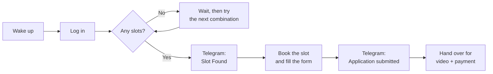
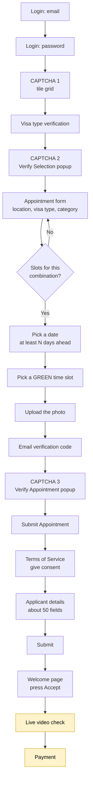
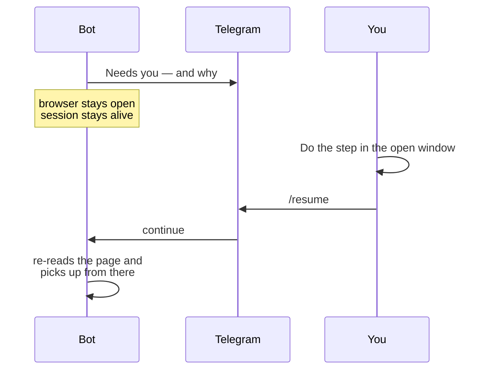
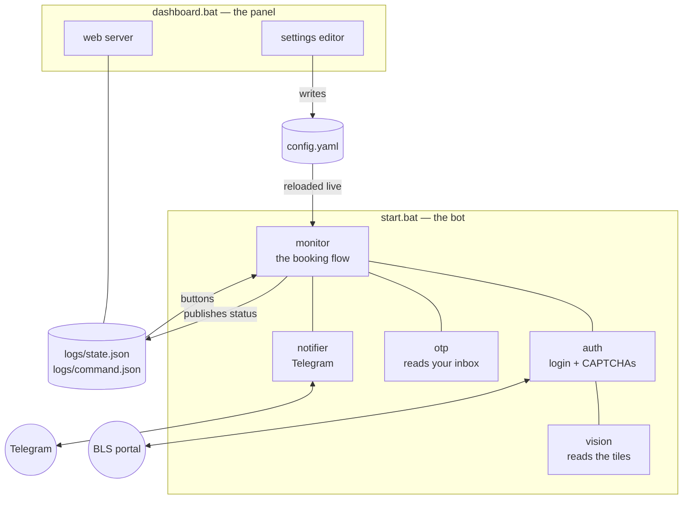

# BLS Spain Egypt — Appointment Bot

Watches the BLS Spain visa portal for Egypt, takes an appointment the moment one
opens, fills in the application, and tells you about it on Telegram. Comes with
a web dashboard in Arabic and English.

It runs on an ordinary Windows PC or a small Linux server, and needs no attention
except for the two steps that require a person — the **live video check**
and the **payment**. It stops at both and waits for you.

---

## Contents

1. [What it does](#1-what-it-does)
2. [How it works](#2-how-it-works)
3. [How the pieces fit together](#3-how-the-pieces-fit-together)
4. [Installing it (Windows)](#4-installing-it-windows)
5. [Installing it (Linux server)](#5-installing-it-linux-server)
6. [Setting it up](#6-setting-it-up)
7. [Day-to-day use](#7-day-to-day-use)
8. [Telegram](#8-telegram)
9. [The dashboard](#9-the-dashboard)
10. [The two steps you have to do yourself](#10-the-two-steps-you-have-to-do-yourself)
11. [What the code is made of](#11-what-the-code-is-made-of)
12. [When something goes wrong](#12-when-something-goes-wrong)
13. [Keeping it safe](#13-keeping-it-safe)

---

## 1. What it does

| | |
|---|---|
| **Watches** | Cairo and Alexandria, continuously, at whatever interval you set |
| **Searches widely** | Every combination of visa type, sub-type, category and applicant type you list |
| **Logs in by itself** | Two-step email → password, keeps the session, logs back in when it expires |
| **Solves the CAPTCHAs** | All three of them, by reading the tiles with GPT-4o vision |
| **Reads the email code** | Fetches the portal's verification code straight from your inbox |
| **Books** | Picks a free date and a green time slot, uploads the photo, fills ~50 application fields |
| **Tells you** | Telegram message when a slot is found, when it is submitted, and whenever it needs you |
| **Shows you** | A dashboard with live status, the full log, and every setting editable in the browser |
| **Knows when to stop** | Live video verification and payment are handed to you, never attempted |

### What it will not do

- It will **not** complete a payment. It stops at the payment page with the
  browser open and waits for you.
- It will **not** perform the live video identity check. That step exists to
  confirm the applicant is personally present, so the applicant does it.
- It will **not** invent application data. Anything it has no value for is
  reported by name rather than guessed at.

---

## 2. How it works

### The short version



### The full journey

Every box below is a real page on the portal. The bot works out which one it is
looking at by reading the page itself, so a refresh, a logout or an unexpected
redirect does not derail it — it simply carries on from wherever it lands.



The two amber boxes are yours. Everything else runs unattended.

### When it needs you



The bot waits indefinitely. It does not time out and throw the booking away.

---

## 3. How the pieces fit together

There are **two programs**, and they are deliberately separate: the dashboard can
be restarted, or closed entirely, without touching a booking in progress.



Two consequences worth knowing:

- **Settings you change in the dashboard reach a running bot** within a couple of
  seconds — no restart. (If the bot is halfway through filling a form, the fields
  already typed keep their old values.)
- **The dashboard's Start button launches the bot** if none is running, and just
  resumes it if one is.

---

## 4. Installing it (Windows)

You need **Python 3.11 or newer**. If you do not have it, get it from
[python.org/downloads](https://www.python.org/downloads/) and **tick "Add Python
to PATH"** during installation — the installer will not work without that.

Then, in the project folder, double-click:

### `install.bat`

That is the whole installation. It creates a private Python environment, installs
everything, and downloads the browser the bot drives. It takes a few minutes and
tells you when it is done.

Then two manual steps:

**1. Create your settings file.** Copy `config.example.yaml` to `config.yaml` and
open it in Notepad:

```bat
copy config.example.yaml config.yaml
notepad config.yaml
```

**2. Put the applicant's documents in the `docs` folder:**

```
docs\passport.jpg     the passport scan
docs\photo.jpg        the applicant's photograph
```

Those filenames come from `config.yaml` — change them there if yours differ.

> **The portal only answers from inside Egypt.** From anywhere else every request
> comes back `403 Forbidden`. Run it on a PC in Egypt, an Egyptian VPS, or through
> an Egyptian VPN.

---

## 5. Installing it (Linux server)

For 24/7 running on a VPS. Use an **Egyptian** host.

```bash
sudo apt update && sudo apt install -y python3 python3-venv python3-pip git

git clone YOUR_REPO_URL bls-egypt-bot
cd bls-egypt-bot

python3 -m venv .venv
source .venv/bin/activate
pip install -r requirements.txt
python -m playwright install --with-deps chromium

cp config.example.yaml config.yaml
nano config.yaml          # set headless: true
```

Run it under systemd so it survives a reboot:

```ini
# /etc/systemd/system/bls-bot.service
[Unit]
Description=BLS Spain Egypt appointment bot
After=network-online.target

[Service]
WorkingDirectory=/home/YOUR_USER/bls-egypt-bot
ExecStart=/home/YOUR_USER/bls-egypt-bot/.venv/bin/python bot.py
Restart=always
RestartSec=30
User=YOUR_USER

[Install]
WantedBy=multi-user.target
```

```bash
sudo systemctl enable --now bls-bot
sudo journalctl -u bls-bot -f      # watch it
```

Do the same with a second unit running `python -m dashboard.server` if you want
the panel.

> On a headless server the bot cannot show you the live video page. Either do
> that step over a remote desktop session, or run the final stage of a booking on
> a PC you can see.

---

## 6. Setting it up

Everything lives in **`config.yaml`**. Every setting is also editable from the
dashboard, which is easier and avoids typos. The file is heavily commented — each
section explains itself.

These are the ones you must fill in before the first run:

| Setting | What it is |
|---|---|
| `bls.email` / `bls.password` | The BLS account the appointment is booked under |
| `applicant.*` | The applicant's details — around 50 fields, all marked `REQ` if the portal demands them |
| `applicant.documents` | Paths to the passport scan and photograph |
| `telegram.token` | From [@BotFather](https://t.me/BotFather) on Telegram |
| `telegram.chat_id` | Your numeric chat id — ask [@userinfobot](https://t.me/userinfobot) |
| `openai.api_key` | For reading the CAPTCHA tiles. Without it the bot asks you to solve them by hand |
| `otp.imap_user` / `otp.imap_pass` | The mailbox that receives the portal's codes. **Gmail needs an [app password](https://myaccount.google.com/apppasswords)**, not the account password |
| `dashboard.password` | Required if you want to reach the dashboard from another computer |

And the ones worth tuning:

| Setting | Default | What it changes |
|---|---|---|
| `poll_interval` | `90` | Seconds between checks |
| `bls.locations` | Cairo, Alexandria | Which centres to watch |
| `min_days_ahead` | `2` | Refuse appointments sooner than this — no use booking tomorrow |
| `combinations_per_cycle` | `1` | How many visa/category combinations to try per cycle |
| `max_combinations_per_cycle` | `12` | Hard ceiling. Each combination costs a CAPTCHA, and too many requests is what gets you rate-limited |
| `headless` | `true` | `false` shows the browser window |
| `logging.retention_days` | `2` | Days of screenshots and page dumps to keep |

### Searching more than one option at a time

Any of these four can be a **single value or a list**. Listing several makes the
bot sweep every combination, which finds openings a single search would miss:

```yaml
bls:
  visa_type:
    - "Schengen visa"
    - "National Visa"
  appointment_category:
    - "Normal"
    - "Premium"
```

> **Careful.** `visa_type` and `visa_sub_type` decide **which visa is applied
> for** — not merely which queue is searched. Sweeping them can win an
> appointment for a visa the applicant does not want. `appointment_category` is
> the safe one to widen: same visa, different service tier, separate slot pool.

---

## 7. Day-to-day use

Six files, all double-clickable.

| File | What it does |
|---|---|
| **`install.bat`** | Sets everything up. Run once. |
| **`start.bat`** | Starts the bot. This is the normal one — it runs until you stop it. |
| **`start_headful.bat`** | One check with a **visible browser**. For trying things out and for seeing what went wrong. |
| **`dashboard.bat`** | Opens the web panel. Separate from the bot; start and stop it freely. |
| **`stop.bat`** | Stops the bot. |
| **`push_logs.bat`** | Sends the log files to GitHub, so whoever is supporting you can read them. |

A normal session:

```
1. dashboard.bat        (optional — opens the panel)
2. start.bat            (the bot begins watching)
3. ... wait for Telegram ...
4. Do the video step and the payment when it asks
5. stop.bat             (when you are done)
```

If you prefer the command line:

```bat
.venv\Scripts\activate

python bot.py                     the normal run
python bot.py --headful           visible browser
python bot.py --once              a single check, then exit
python bot.py --no-dashboard      do not publish status to the dashboard
python bot.py --config other.yaml a different settings file
```

Stop it with **Ctrl+C**, `stop.bat`, the dashboard **Stop** button, or Telegram
**/stop**.

---

## 8. Telegram

Set `telegram.token` and `telegram.chat_id` and you get a message whenever
anything happens.

| Message | When |
|---|---|
| 🤖 **Bot started** | On startup, listing every option it will search |
| 🟢 **Slot Found** | The moment an opening appears, naming the exact combination |
| ✅ **Application submitted** | The form went through — with a full summary of what was submitted |
| 🟠 **Manual step required** | It needs you: video check, payment, or a field it has no value for |
| 🔴 **Error** | Something failed, and what happens next |
| ℹ️ **Status** | A heartbeat every `telegram.heartbeat_hours` so you know it is alive |

Commands you can send it:

```
/status   what it is doing right now
/resume   carry on after you have done a manual step
/stop     shut down cleanly
/help     this list
```

A real `Slot Found` message looks like this:

```
🟢 Slot Found
Location: Cairo
Category: Normal
Appointment For: Individual
Visa type: Schengen visa
Visa sub type: Airport Transit Visa (TAP)

Booking now…
```

And the confirmation summarises everything that was submitted:

```
✅ Application submitted

The applicant form was accepted and the appointment is held.

👤 APPLICANT
Name: …
Date of birth: …
Passport: …

📅 APPOINTMENT
Centre: Cairo
Date & time: 2026-10-15 at 09:00-10:00
Visa: Schengen visa · Airport Transit Visa (TAP)

✈️ TRIP
Travel date: …
Arrival → departure: …
Staying at: …

➡️ NEXT: live video verification — the applicant has to do this one in
person. The browser is open and waiting; send /resume when it is done.
```

---

## 9. The dashboard

Start it with **`dashboard.bat`**, then open:

```
http://127.0.0.1:5000
```

It is a separate program from the bot. Closing it does not stop a booking, and
you do not need it at all if you are happy with Telegram.

### What is on it

**Overview** — whether the bot is online, what it is doing, how long it has been
up, each centre's last check, what has been booked, and a live log that refreshes
every few seconds.

**Settings** — every entry in `config.yaml`, editable in the browser. Changes
reach a running bot within a couple of seconds; passwords and keys are masked and
stay masked unless you deliberately replace them. Your comments in the file are
preserved.

**Controls** — Start, Pause, Resume and Stop. **Start launches the bot** if none
is running, so you can run the whole thing from the panel.

**Language** — Arabic (right-to-left) and English, switchable with one button.
Set the default with `dashboard.default_language`.

### Reaching it from another computer

In `config.yaml`:

```yaml
dashboard:
  host: "0.0.0.0"              # accept connections from the network
  password: "something-long"   # mandatory as soon as host is not 127.0.0.1
  port: 5000
```

Then restart `dashboard.bat` and browse to `http://THAT-MACHINES-IP:5000`.

> The dashboard **refuses to start** on a network address with no password set.
> It shows the applicant's personal data and edits the file holding the portal
> password, the Telegram token and the OpenAI key.
>
> Traffic is plain HTTP. On anything beyond a trusted local network, put it
> behind a VPN or an HTTPS reverse proxy — otherwise the password and everything
> it protects cross the network readable.

---

## 10. The two steps you have to do yourself

### The live video check

The portal asks the applicant to appear on camera. This is an identity check: its
whole purpose is to confirm the applicant is personally present. The bot does not
touch it.

What happens: Telegram message with a screenshot, the browser stays open on the
page, and the bot waits. The applicant does the check in that window, then you
send **`/resume`**.

### The payment

The bot never spends money. When the booking reaches the payment page it stops,
messages you, leaves the browser open on that page, and waits — with no time
limit — for **`/resume`**.

Enter the card details yourself in that window. Then `/resume`, and the bot
re-reads the page and carries on.

### And if the portal rejects something

The portal has validation rules that are not published — one example it enforces
is that the employer address may contain no digits or punctuation. If it refuses
the form, the bot:

1. sends you **exactly what the portal said**, plus the setting it refers to,
2. leaves the browser open on the filled-in form,
3. waits for `/resume`.

You can correct the field in that window and press Submit yourself, or fix it in
the dashboard. The bot then checks the page rather than assuming anything.

---

## 11. What the code is made of

Python 3.11+, around 13,900 lines. Playwright drives a real Chromium browser;
Flask serves the dashboard.

```
bls-egypt-bot/
├── bot.py                    start-up, the main loop, the dashboard bridge
├── config.yaml               your settings          (never committed)
├── config.example.yaml       the documented template
├── requirements.txt          pinned dependencies
│
├── modules/
│   ├── monitor.py            the booking flow, end to end
│   ├── auth.py               login, session, all three CAPTCHAs
│   ├── vision.py             reads the CAPTCHA tiles with GPT-4o
│   ├── booking.py            slot selection helpers
│   ├── documents.py          file uploads
│   ├── notifier.py           Telegram out, and commands in
│   ├── otp.py                reads the portal's code from your inbox
│   ├── state.py              what the bot is doing, for the dashboard
│   ├── ipc.py                the two files the bot and panel talk through
│   └── utils.py              delays, screenshots, page dumps, retries
│
├── dashboard/
│   ├── server.py             the standalone panel process
│   ├── app.py                routes and login
│   ├── config_api.py         reads and writes config.yaml, comments intact
│   ├── templates/index.html  the page (Arabic/English, RTL)
│   └── static/style.css
│
├── docs/                     the applicant's documents   (never committed)
├── session/cookies.json      the saved login             (never committed)
└── logs/                     log, screenshots, page dumps
```

| File | Lines | What it is responsible for |
|---|---:|---|
| `modules/monitor.py` | 5,360 | The whole booking journey: the sweep, the calendar, the slot, the two big forms, and working out which page it is on |
| `modules/auth.py` | 2,880 | Logging in past 10 decoy fields, keeping the session, and solving the three CAPTCHAs |
| `bot.py` | 691 | Configuration, logging, the main loop, and the bridge to the dashboard |
| `modules/utils.py` | 683 | Human-like delays, screenshots, page dumps, retries, log pruning |
| `dashboard/templates/index.html` | 635 | The panel itself |
| `dashboard/static/style.css` | 622 | Its styling, light and dark, LTR and RTL |
| `modules/vision.py` | 460 | Nine tile images to GPT-4o at once, and the digits back |
| `modules/booking.py` | 425 | Slot selection helpers |
| `modules/notifier.py` | 415 | Every Telegram message, and the command listener |
| `modules/state.py` | 303 | The live picture of what the bot is doing |
| `modules/otp.py` | 293 | IMAP, or asking you on Telegram |
| `dashboard/server.py` | 266 | The standalone panel, its password gate, and launching the bot |
| `dashboard/config_api.py` | 233 | Editing `config.yaml` without destroying its comments |
| `modules/documents.py` | 232 | Uploads, including the awkward widgets |
| `dashboard/app.py` | 222 | Routes, sessions, the settings API |
| `modules/ipc.py` | 121 | `logs/state.json` and `logs/command.json`, written atomically |

### Two things about this portal worth knowing

**The login page is a trap.** It has ten fields all labelled "Email", nine of
them hidden decoys. The ids, the names and **which one is real** all change on
every page load. The bot finds the real one by asking the browser which is
actually displayed — never by position or name. The appointment form does the
same thing with five copies of every field.

**It watches how you behave.** The portal records how long you take between
opening a dropdown and choosing from it, and rejects anything that looks
mechanical. The bot presses the control, pauses the way a person reading the
options would, and then presses the choice — the timing it reports is real,
because it actually happened.

---

## 12. When something goes wrong

Everything the bot sees is on disk:

```
logs/bot.log                     everything, with timestamps
logs/run_<date>_<time>.txt       one file per run
logs/screenshots/                a picture of every unexpected page
logs/dom/                        the page's code, for diagnosis
```

Only the last `logging.retention_days` days are kept (2 by default) — they add up
fast. **`push_logs.bat`** sends them to GitHub for whoever is supporting you.

| What you see | What it means | What to do |
|---|---|---|
| `403 Forbidden` | The portal is refusing your connection because it is not Egyptian | Run from Egypt, an Egyptian VPS, or an Egyptian VPN |
| `could not locate the real email field` | Usually the login page never loaded at all | Check the log just above it for a failed or timed-out request |
| `no slots` repeatedly | Normal. There genuinely are none | Nothing. Leave it running |
| `appointment already initiated … 27 minutes` | A previous booking was left half-finished; the portal is holding it | Nothing. The bot waits out the hold and retries |
| `required settings are blank` | The application needs a value you have not given | The message names the setting. Fill it in the dashboard |
| `Special Characters and Numbers are not allowed in …` | A portal validation rule | The message names the setting. Edit it, or fix it in the open browser and `/resume` |
| Dashboard says **offline** | No bot is running | Press **Start** in the panel, or run `start.bat` |
| `Start` does nothing | The bot could not launch | Read `logs/dashboard-launch.log` |
| Bot stops at a page you were not expecting | It stopped deliberately rather than guess | Read the Telegram message; it says what it was unsure about |

To see what is happening with your own eyes, run **`start_headful.bat`**. It opens
a real browser window, does one check, and stops. With
`debug.keep_browser_open: true` in your config it also leaves the window open
when a step fails, so you can inspect the half-filled page.

---

## 13. Keeping it safe

**`config.yaml` holds the portal password, the Telegram token, the OpenAI key and
the applicant's passport details.** It is listed in `.gitignore` and is never
committed. The same goes for `docs/` and `session/cookies.json`.

- Keep the repository **private**. The logs that are committed contain the pages
  the portal served.
- Only set `dashboard.host: "0.0.0.0"` behind a VPN or an HTTPS proxy. The
  dashboard will not start on a network address without a password, but HTTP is
  still HTTP.
- `session/cookies.json` is a logged-in session. Treat it like the password.
- No credential appears anywhere in the source code.

---

## Quick reference

```
install.bat            set everything up (once)
start.bat              start the bot
start_headful.bat      one check, visible browser
dashboard.bat          open the web panel
stop.bat               stop the bot
push_logs.bat          send logs to GitHub

http://127.0.0.1:5000  the dashboard

/status /resume /stop /help     on Telegram
```

**The bot needs you for exactly two things: the live video check, and the
payment.** It will ask, it will wait, and it will not give up your appointment
while it waits.
