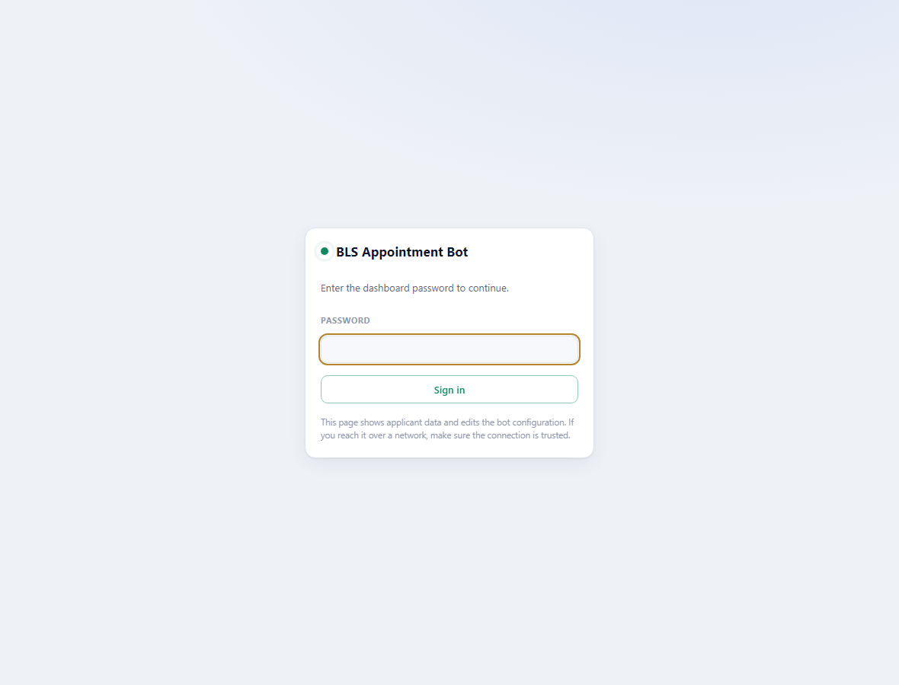
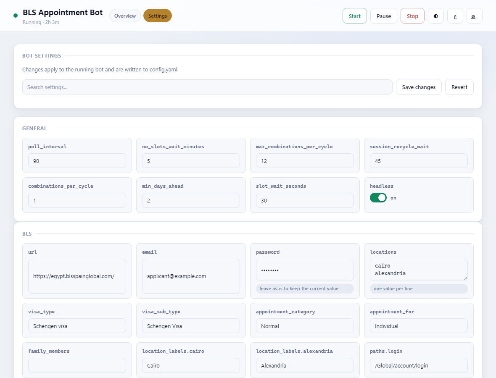
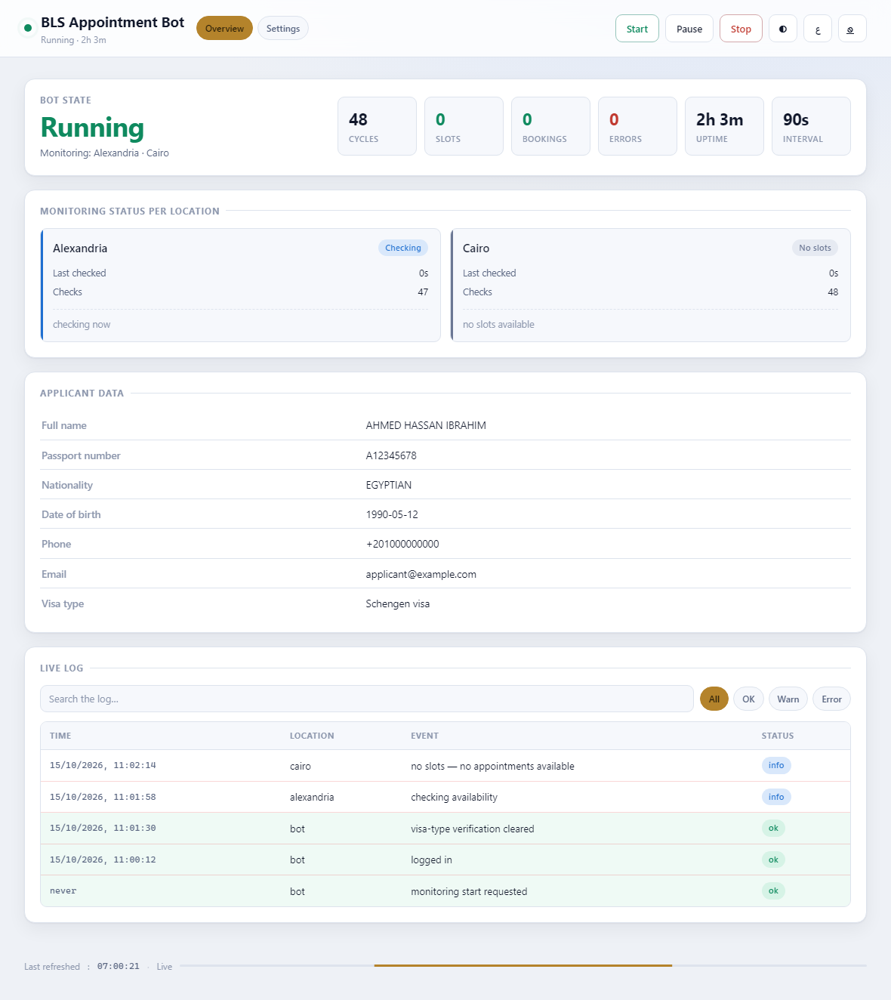
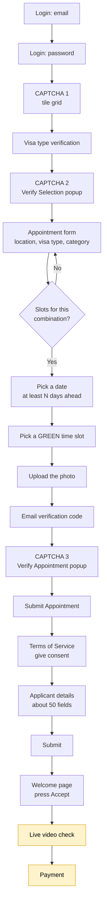
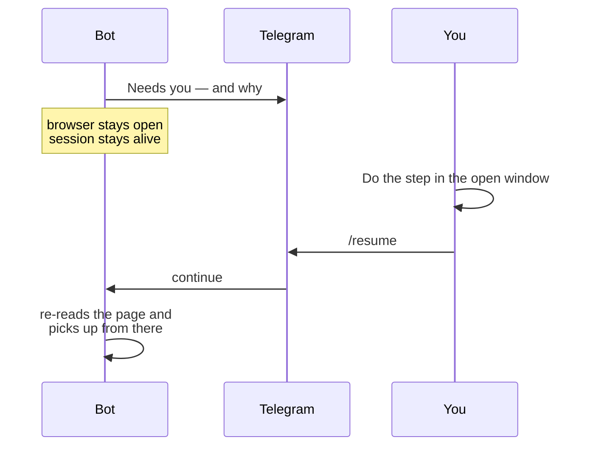
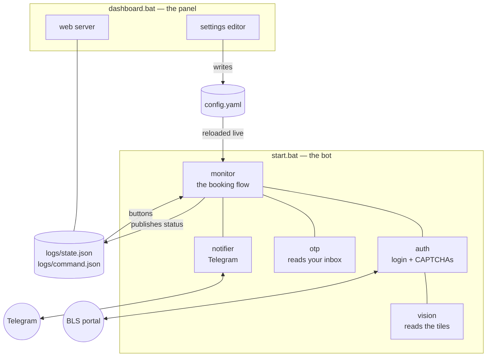

# BLS Spain Egypt — Appointment Bot

This program watches the BLS Spain visa website for Egypt. The moment an
appointment becomes free in **Cairo** or **Alexandria** it takes it, fills in
the application form, and sends you a message on Telegram.

It does almost everything on its own. **You only have to do two things**: the
live video check, and the payment. It will tell you when, and it will wait for
you.

---

> ### New here? Read Part 1 and stop.
>
> **[Part 1 — Using the bot](#part-1--using-the-bot)** is written for the person
> who will run this. No programming needed. Everything is a double-click.
>
> [Part 2 — Technical reference](#part-2--technical-reference) is for whoever
> maintains the code.

---

# Part 1 — Using the bot

### The whole thing in four steps

```
   ①  install.bat        →  ②  dashboard.bat      →  ③  start.bat        →  ④  Telegram
      install it,            type in your             let it run,            do the video
      once                   details                  day and night          check + pay
```

Steps ① to ③ take about half an hour, once. After that you only touch step ④.

1. [Before you start](#1-before-you-start)
2. [Install it (once)](#2-install-it-once)
3. [Enter your details](#3-enter-your-details)
4. [Start the bot](#4-start-the-bot)
5. [What happens next](#5-what-happens-next)
6. [Your two jobs](#6-your-two-jobs)
7. [Stopping the bot](#7-stopping-the-bot)
8. [The dashboard](#8-the-dashboard)
9. [Telegram commands](#9-telegram-commands)
10. [If something looks wrong](#10-if-something-looks-wrong)

---

## 1. Before you start

Tick these off before you begin. You only do this once.

- [ ] **A Windows computer in Egypt, that stays switched on.**
      The BLS website only answers from inside Egypt — from anywhere else it
      refuses every request. The bot must keep running, so the computer cannot
      be shut down or put to sleep.

- [ ] **Python installed.**
      Free, from [python.org/downloads](https://www.python.org/downloads/).
      While installing, **tick the box that says "Add Python to PATH"**:

      ```
      ┌──────────────────────────────────────────────┐
      │  Install Python 3.13                         │
      │                                              │
      │   [ ] Install launcher for all users         │
      │   [✓] Add Python to PATH     ← TICK THIS     │
      │                                              │
      │              [ Install Now ]                 │
      └──────────────────────────────────────────────┘
      ```

      If you miss it, nothing will work. Just install Python again and tick it.

- [ ] **Your BLS sign-in** — the email and password you use on the BLS website.

- [ ] **Two files**: a scan of the passport, and the applicant's photograph.

- [ ] **Telegram on your phone** — this is how the bot talks to you.

### Setting up Telegram (five minutes)

You need two things from Telegram: a **token** and a **chat id**.

**① The token** — open Telegram, search for **@BotFather**, press Start, then:

> **You:** `/newbot`
> **BotFather:** Alright, a new bot. How are we going to call it?
> **You:** `My Visa Bot`
> **BotFather:** Good. Now let's choose a username…
> **You:** `my_visa_appointment_bot`  *(must end in `bot`)*
> **BotFather:** Done! Use this token to access the HTTP API:
> **`8971494456:AAGvIzAf3kLf74PkhqoMNvL4iLP7qdFePsU`**

That long line is your **token**. Copy it.

**② The chat id** — search for **@userinfobot**, press Start:

> **@userinfobot:** Id: **`123456789`**
> First: Ahmed
> Lang: en

That number is your **chat id**. Copy it.

Keep both open somewhere — you paste them in [step 3](#3-enter-your-details).

---

## 2. Install it (once)

### Double-click `install.bat`

A black window opens and does everything by itself. It takes a few minutes.

**What you'll see:**

```
===========================================================
   BLS Appointment Bot - Installation
===========================================================

Python found: Python 3.13.1

[1 of 3] Updating pip ...
[2 of 3] Installing the Python packages ...
[3 of 3] Downloading the Chromium browser (about 140 MB) ...
This part is slow. Please wait, do not close this window.

===========================================================
   Installation complete!
===========================================================
```

> ✅ **It worked if** you see *Installation complete!*
>
> ❌ **"Python was not found"** → Python is not installed, or the "Add Python to
> PATH" box was not ticked. Install Python again, tick the box, then run
> `install.bat` again.

### Then add the two documents

Put them in the **`docs`** folder inside the bot's folder:

```
bls-egypt-bot\
│
├── docs\
│   ├── passport.jpg     ← the passport scan
│   └── photo.jpg        ← the applicant's photograph
│
├── install.bat
├── start.bat
└── dashboard.bat
```

Use exactly those two names, or change them later in the settings.

---

## 3. Enter your details

This is the longest step, and you only do it once. Use the settings page — it
is far easier than editing files.

### ① Double-click `dashboard.bat`

A black window opens. **Leave it open** — closing it closes the settings page.

### ② Open your web browser and go to

```
http://127.0.0.1:5000
```

You will see this:



The password is whatever is in `dashboard.password`. On a fresh install it is
empty, so just press **Sign in**.

### ③ Click **Settings** at the top



Every box is one setting. Type in it, then press **Save changes** at the top.
Use the **search box** to find a setting quickly instead of scrolling.

> The page is in Arabic and English. The **EN / ع** button at the top right
> switches between them.

### What to fill in

| Setting | Example | Where it comes from |
|---|---|---|
| `bls.email` | `applicant@gmail.com` | Your BLS website sign-in |
| `bls.password` | `••••••••` | Your BLS website sign-in |
| `telegram.token` | `8971494456:AAGvIz…` | @BotFather, [step 1](#1-before-you-start) |
| `telegram.chat_id` | `123456789` | @userinfobot, [step 1](#1-before-you-start) |
| `otp.imap_user` | `applicant@gmail.com` | The inbox that receives BLS codes |
| `otp.imap_pass` | `abcd efgh ijkl mnop` | **Gmail needs an [app password](https://myaccount.google.com/apppasswords)**, not your normal one |
| `openai.api_key` | `sk-proj-…` | [platform.openai.com](https://platform.openai.com/api-keys) — the bot uses it to read the puzzle pictures |
| `applicant.*` | see below | The applicant's own details |

The `applicant` section is the big one — about fifty boxes. Every one marked
**REQ** must be filled, or the BLS website will refuse the application:

| Setting | Example |
|---|---|
| `applicant.first_name` | `AHMED HASSAN` |
| `applicant.surname` | `IBRAHIM` |
| `applicant.dob` | `1990-05-12` |
| `applicant.passport_number` | `A12345678` |
| `applicant.passport_expiry_date` | `2033-02-27` |
| `applicant.travel_date` | `2026-12-13` |
| `applicant.hotel_name` | `Hostal Nova, Barcelona` |
| `applicant.arrival_date` | `2027-01-18` |
| `applicant.departure_date` | `2027-01-31` |

**Dates are always `YYYY-MM-DD`** — year, month, day. `2027-01-18` means
18 January 2027.

> ### Don't know a value? Start anyway.
>
> The bot checks everything the moment it starts and sends you a Telegram
> message naming exactly what is missing — before it does anything else. You do
> not have to get it all right first time.

**If two people need the bot** (say, you and the applicant), put both chat ids:

```yaml
telegram:
  chat_id:
    - "123456789"      # you
    - "987654321"      # the applicant
```

Anyone not on that list is ignored — but the bot replies telling them their own
chat id, so you can add it.

---

## 4. Start the bot

### Double-click `start.bat`

**Two windows open. Both must stay open:**

```
┌─ Black text window ──────────────┐   ┌─ Browser window ─────────────────┐
│                                  │   │                                  │
│  BLS Appointment Bot - Start     │   │   the BLS website                │
│                                  │   │                                  │
│  A browser window will open and  │   │   This is where YOU will         │
│  STAY open while the bot runs.   │   │   finish the booking later.      │
│                                  │   │                                  │
│  11:00:12  logged in             │   │   Do not close it.               │
│  11:01:30  verification cleared  │   │   Do not type in it.             │
│  11:02:14  cairo: no slots       │   │   You may minimise it.           │
│                                  │   │                                  │
└──────────────────────────────────┘   └──────────────────────────────────┘
        what it is doing                    where you will be needed
```

> ### ⚠️ Leave the browser window alone
>
> That window holds your place in the queue. **If you close it, the bot loses
> the appointment.** You can minimise it — just do not close it.

You will also get a Telegram message straight away:

```
🤖 Bot started
Locations: ['Cairo', 'Alexandria'],
Category: ['Normal']
Appointment For: ['Individual'],
Visa type: ['Schengen visa'],
Visa sub type: ['Schengen Visa']
Interval: 90s

Send /help for commands.
```

> ✅ **It worked if** that message arrives on Telegram.
>
> ❌ **No message?** Your `telegram.token` or `telegram.chat_id` is wrong. Check
> them in the settings page.

That's it. The bot now checks for appointments over and over, day and night.
**You can walk away.**

---

## 5. What happens next

Everything arrives on Telegram. You do not need to watch the screen.

| Message | What it means | What to do |
|---|---|---|
| 🤖 **Bot started** | It is running | Nothing |
| 🟢 **Slot Found** | An appointment is free and it is taking it | Nothing — but stay near your phone |
| ✅ **Application submitted** | The form went through. The appointment is being held for you | **Get ready — your part is next** |
| 🎥 **Live video verification** | It needs you now | See [Your two jobs](#6-your-two-jobs) |
| 💳 **Payment** | It needs you now | See [Your two jobs](#6-your-two-jobs) |
| ℹ️ **Status** | A "still alive" note every few hours | Nothing |
| 🔴 **Error** | Something went wrong | Usually nothing — it retries by itself, and the message says so |

A real one looks like this:

```
🟢 Slot Found
Location: Cairo
Category: Normal
Appointment For: Individual
Visa type: Schengen visa
Visa sub type: Airport Transit Visa (TAP)

Booking now…
```

---

## 6. Your two jobs

The bot does everything up to here on its own. These last two steps are yours.

```
   bot finds a slot  →  bot fills the form  →  🎥 YOU: video  →  💳 YOU: pay  →  done
      automatic            automatic            the bot waits    the bot waits
```

> ### ⏱️ Be quick
>
> BLS only holds an unfinished appointment for a short time. Treat these
> messages as **"do it now"**, not "do it this evening".
>
> **Turn Telegram notifications on for this chat**, and keep your phone nearby
> once you get the ✅ *Application submitted* message.

---

### 🎥 Job 1 — the live video check

**You get this on Telegram** (with a picture of the page):

```
🟠 MANUAL STEP REQUIRED
🎥 The booking has reached the LIVE VIDEO verification step.

This one confirms the applicant is personally present, so it has to be
done by them, on this machine — the browser is open and waiting.

Page: https://egypt.blsspainglobal.com/Global/BlsAppointment/livenessView…

The bot is paused. Finish the step in the browser, then send /resume.
```

**What to do:**

| | |
|---|---|
| **1** | Go to the computer running the bot |
| **2** | Open the **browser window** that has been sitting there all along |
| **3** | Do the camera check. **The applicant must be the person in front of the camera** — confirming that is the entire point of this step |
| **4** | Send **`/resume`** to the bot on Telegram |

The bot then reads the page again and carries on by itself.

---

### 💳 Job 2 — the payment

**You get this on Telegram:**

```
🟠 MANUAL STEP REQUIRED
💳 The booking has reached the PAYMENT step.

The browser window is still open on the payment page. Pay there by
hand — the bot will not touch it.

The bot is paused. Finish the step in the browser, then send /resume.
```

**What to do:**

| | |
|---|---|
| **1** | Same browser window |
| **2** | Enter the card details and pay |
| **3** | Send **`/resume`** on Telegram |

> **The bot never spends money.** It stops at the payment page and waits — with
> **no time limit** — until you tell it to carry on. It will wait all night if
> it has to.

---

### If you are not at that computer

The browser window is on the Egypt machine, so the step has to happen there.
Install **AnyDesk** or **TeamViewer** on it beforehand, and you can connect from
anywhere when the message arrives.

---

## 7. Stopping the bot

Any of these:

- **Double-click `stop.bat`**
- Press **Ctrl+C** in the black text window
- Send **`/stop`** on Telegram
- Click **Stop** on the dashboard

To start it again: `start.bat`, or the **Start** button on the dashboard.

---

## 8. The dashboard

A web page showing what the bot is doing. It is optional — Telegram tells you
everything important — but it is useful.

**Double-click `dashboard.bat`**, then open **http://127.0.0.1:5000**



Reading it top to bottom:

| On the page | What it tells you |
|---|---|
| **Running · 2h 3m** | The bot is alive and has been for two hours |
| **CYCLES / SLOTS / BOOKINGS / ERRORS** | Running totals since it started |
| **Monitoring status per location** | When each city was last checked, and what was found |
| **Applicant data** | A summary of whose appointment this is — handy for spotting a typo |
| **Live log** | Everything that has happened, newest first. Search it, or filter to just errors |
| **Start / Pause / Stop** | Same controls as the batch files |

The dashboard is separate from the bot. Closing it does not stop a booking, and
you do not need it open for the bot to work.

> **After updating the bot's files, close the dashboard and open it again.**
> It keeps running the version it started with. If the page shows a red warning
> saying exactly that, this is why.

### Opening it from another computer or phone

In the settings, set:

| Setting | Value |
|---|---|
| `dashboard.host` | `0.0.0.0` |
| `dashboard.password` | A long password you choose |

Restart `dashboard.bat`, then browse to `http://<that computer's IP>:5000`.

> It **will not start** on a network address without a password, because the
> page shows personal data and the account password. Only do this on a network
> you trust.

---

## 9. Telegram commands

```
/start    begin or resume checking
/status   what it is doing right now
/resume   carry on, after you have done the video check or the payment
/stop     stop it
/help     this list
```

> **`/start` talks to a bot that is already running.** It cannot switch the
> computer on. If nothing is running, use `start.bat` or the dashboard's Start
> button first.

---

## 10. If something looks wrong

| What you see | What it means | What to do |
|---|---|---|
| "403 Forbidden" | The website is refusing your internet connection | The computer must be in Egypt. If it is, the website has temporarily blocked it for asking too often — the bot waits and retries by itself, waiting longer each time |
| "no slots" over and over | Normal. There really are none | Nothing. Leave it running |
| "appointment already initiated … 27 minutes" | An earlier booking was left unfinished | Nothing. It waits and tries again |
| "required settings are blank" | The application needs something you have not entered | The message names it. Put it in the settings page |
| "Special Characters and Numbers are not allowed in …" | A BLS rule about what a box may contain | The message names the setting. Fix it in the settings page, or correct it in the open browser window yourself and send `/resume` |
| 502 / "captcha service" messages | The BLS website's own puzzle service is down | Nothing. It retries |
| Dashboard says **offline** | No bot is running | Press **Start**, or run `start.bat` |
| You typed `/start` and nothing happened | Your Telegram chat is not on the allowed list | The bot replies with your chat id — add it to `telegram.chat_id` |

Everything the bot sees is saved in the `logs` folder: a full diary, pictures of
every unexpected page, and the page contents. **`push_logs.bat`** sends them to
whoever supports you.

---
---

# Part 2 — Technical reference

For whoever maintains this. Python 3.11+, Playwright driving a real Chromium,
Flask for the dashboard.

## The booking journey

Every box is a real page on the portal. The bot identifies which one it is
looking at by reading the page itself, so a refresh, a logout or an unexpected
redirect does not derail it — it carries on from wherever it lands.



The two amber boxes are handed to a person. Everything else is unattended.

## How a hand-over works



The browser context is never closed at those points — same live Chromium, same
cookies, same hold on the appointment. `wait_for_resume()` has no timeout.

**This is why `start.bat` passes `--headful`**, overriding `headless` in
`config.yaml`. Run headless and the bot reaches the video page, holds the
appointment, and waits for a `/resume` nobody can act on. A plain
`python bot.py` still honours the config setting, for a server run that is not
expected to finish a booking.

## The two processes



Deliberately separate: the dashboard can be restarted, or closed, without
touching a booking in progress. Settings edits reach a running bot in about two
seconds. The dashboard's Start button launches `bot.py` when nothing is running.

## Command line

```bat
python bot.py                     normal run, honours config headless
python bot.py --headful           force a visible browser (what start.bat uses)
python bot.py --once              a single check, then exit
python bot.py --no-dashboard      do not publish status for the dashboard
python bot.py --config other.yaml a different settings file
```

## The launchers

| File | What it runs |
|---|---|
| `install.bat` | venv, dependencies, Chromium |
| `start.bat` | `python bot.py --headful` — continuous, visible browser |
| `start_headful.bat` | `python bot.py --headful --once` — one check, for debugging |
| `dashboard.bat` | `python -m dashboard.server` |
| `stop.bat` | terminates the bot process |
| `push_logs.bat` | commits and pushes `logs/` |

## Settings worth knowing

| Setting | Default | Effect |
|---|---|---|
| `poll_interval` | `90` | Seconds between checks |
| `no_slots_wait_minutes` | `5` | Wait after the portal reports no slots. **The main lever on how much traffic you generate** |
| `min_days_ahead` | `2` | Reject appointments sooner than this; the portal offers dates it will not serve slots for |
| `combinations_per_cycle` | `1` | Option combinations tried per cycle — each costs a login and two CAPTCHAs |
| `max_combinations_per_cycle` | `12` | Hard ceiling on the sweep |
| `block_cooldown_minutes` | `8` | First wait after a 403 |
| `block_cooldown_max_minutes` | `180` | Ceiling; each consecutive block doubles the wait, and a successful login resets it |
| `logging.retention_days` | `2` | Days of screenshots and page dumps kept |
| `debug.keep_browser_open` | `false` | Hold the window open on a failure. Defaults to on when headful |

`bls.visa_type`, `visa_sub_type`, `appointment_category` and `appointment_for`
each accept a **list**, and the cross-product is swept.

> `visa_type` and `visa_sub_type` decide **which visa is applied for**, not
> merely which queue is searched. Sweeping them can win an appointment for a
> visa the applicant does not want. `appointment_category` is the safe one to
> widen: same visa, different service tier, separate slot pool.

## Installing on a Linux server

Use an **Egyptian** host.

```bash
sudo apt update && sudo apt install -y python3 python3-venv python3-pip git
git clone YOUR_REPO_URL bls-egypt-bot && cd bls-egypt-bot
python3 -m venv .venv && source .venv/bin/activate
pip install -r requirements.txt
python -m playwright install --with-deps chromium
cp config.example.yaml config.yaml && nano config.yaml
```

```ini
# /etc/systemd/system/bls-bot.service
[Unit]
Description=BLS Spain Egypt appointment bot
After=network-online.target

[Service]
WorkingDirectory=/home/YOUR_USER/bls-egypt-bot
ExecStart=/home/YOUR_USER/bls-egypt-bot/.venv/bin/python bot.py
Restart=always
RestartSec=30
User=YOUR_USER

[Install]
WantedBy=multi-user.target
```

```bash
sudo systemctl enable --now bls-bot
sudo journalctl -u bls-bot -f
```

> A headless server **cannot complete the video check or the payment**. Either
> do that stage over a remote desktop session, or run the final part of a
> booking on a machine someone can see.

## The code

```
bls-egypt-bot/
├── bot.py                    start-up, the main loop, the dashboard bridge
├── config.yaml               settings              (never committed)
├── config.example.yaml       documented template
│
├── modules/
│   ├── monitor.py            the booking flow, end to end
│   ├── auth.py               login, session, all three CAPTCHAs
│   ├── vision.py             reads the CAPTCHA tiles with GPT-4o
│   ├── booking.py            slot selection helpers
│   ├── documents.py          file uploads
│   ├── notifier.py           Telegram out, and commands in
│   ├── otp.py                reads the portal's code from the inbox
│   ├── state.py              what the bot is doing, for the dashboard
│   ├── ipc.py                the two files the bot and panel talk through
│   └── utils.py              delays, screenshots, page dumps, retries
│
├── dashboard/
│   ├── server.py             the standalone panel process
│   ├── app.py                routes and login
│   ├── config_api.py         reads and writes config.yaml, comments intact
│   ├── templates/index.html  the page (Arabic/English, RTL)
│   └── static/style.css
│
├── docs/                     applicant documents   (never committed)
├── session/cookies.json      the saved login       (never committed)
└── logs/                     log, screenshots, page dumps
```

| File | Lines | Responsible for |
|---|---:|---|
| `modules/monitor.py` | 5,400 | The whole booking journey: the sweep, the calendar, the slot, both big forms, and working out which page it is on |
| `modules/auth.py` | 2,900 | Logging in past 10 decoy fields, keeping the session, and the three CAPTCHAs |
| `bot.py` | 700 | Config, logging, the main loop, the dashboard bridge |
| `modules/utils.py` | 700 | Human-like delays, screenshots, page dumps, retries, log pruning, block backoff |
| `dashboard/templates/index.html` | 640 | The panel |
| `dashboard/static/style.css` | 620 | Light and dark, LTR and RTL |
| `modules/vision.py` | 460 | Nine tile images to GPT-4o at once, digits back |
| `modules/notifier.py` | 440 | Every Telegram message, and the command listener |
| `modules/booking.py` | 425 | Slot selection helpers |
| `modules/state.py` | 300 | The live picture of what the bot is doing |
| `dashboard/server.py` | 300 | The standalone panel, its password gate, launching the bot |
| `modules/otp.py` | 290 | IMAP, or asking over Telegram |
| `dashboard/config_api.py` | 233 | Editing `config.yaml` without destroying its comments |
| `modules/documents.py` | 232 | Uploads, including the awkward widgets |
| `dashboard/app.py` | 230 | Routes, sessions, the settings API |
| `modules/ipc.py` | 121 | `logs/state.json` and `logs/command.json`, written atomically |

### Two things about this portal

**The login page is a trap.** Ten fields all labelled "Email", nine of them
hidden decoys. The ids, the names and *which one is real* change on every page
load. The bot asks the browser which one is actually displayed — never position
or name. The appointment form does the same with five copies of every field.

**It watches how you behave.** The portal records how long you take between
opening a dropdown and choosing from it, and rejects anything that looks
mechanical. The bot presses the control, pauses the way a person reading the
options would, then presses the choice — the timing it reports is real, because
it actually happened.

## Keeping it safe

`config.yaml` holds the portal password, the Telegram token, the OpenAI key and
the applicant's passport details. It is gitignored, along with `docs/`,
`session/cookies.json`, any `*.bak` or `*.tmp`, and the IPC scratch files.

- Keep the repository **private**. The committed logs contain pages the portal
  served while logged in.
- Only expose the dashboard beyond loopback behind a VPN or an HTTPS proxy.
- `session/cookies.json` is a logged-in session. Treat it like the password.
- No credential appears anywhere in the source.

---

## Quick reference

```
install.bat            set everything up (once)
start.bat              start the bot (visible browser)
start_headful.bat      one check, for debugging
dashboard.bat          open the web panel
stop.bat               stop the bot
push_logs.bat          send logs to GitHub

http://127.0.0.1:5000  the dashboard

/start /status /resume /stop /help    on Telegram
```

**The bot needs you for exactly two things: the live video check, and the
payment.** It will ask, it will wait, and it will not give up your appointment
while it waits.
